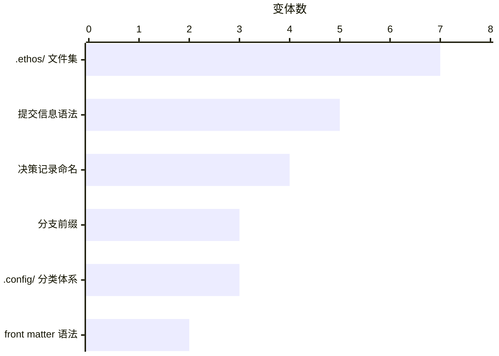

# ETHOS 如何让人和 AI Agent 只凭证据改动仓库？ {#guide}

ETHOS 只凭证据准入改动：OpenSpec 正式变更陈述意图，刚观察到的事实陈述现状，只有判定为 `pass` 的计划才准入改动。客户端的声明、聊天记录或先前的成功都不授予决定权，因为每项改动都会重新核对决定权。同一个小内核既治理 ETHOS 自身，也治理每个接入它的仓库。

- [它只负责一项判断](block:p-context)：一次改动能否准入。Git、OpenSpec、CI 和你的其他工具都保持原生。
- [任何 Agent 都能接手一条通道](block:p-lane)，只凭 Git、OpenSpec、刚观察到的事实和核验记录，无须旁人复述。
- [每项改动都经过编译、判断和当场准入，并以确切的 compare-and-swap 执行](block:p-plan)。
- [每种证据只证明它所在的平面](block:p-evidence)，所以本地证明不是防伪保证。

@answer scope="ETHOS v0.2.0-beta.6 · 提交 727ee05 · 其源码与自身文档 · 证明耗时实测于 2026-11-08"
@meta locale=zh-CN style=editorial
@source kernel title="内核" path="README.md" lines=100:107
@source native title="哪些保持原生" path="README.md" lines=26:29
@source visibility title="看得到不等于有决定权" path="README.md" lines=91:93
@source isomorphic title="同构治理" path="README.md" lines=33:38
@source status title="有界的读取入口" path="README.md" lines=56:58
@source maturity-readme title="内核与完整的承诺" path="README.md" lines=18:24
@source product-kernel title="信任内核" path="docs/governance/product-design-contract.md" lines=25:30
@source promise title="承诺" path="docs/governance/product-design-contract.md" lines=32:36
@source root-constraint title="根本约束" path="docs/governance/product-design-contract.md" lines=44:51
@source custom-code title="ETHOS 在哪里自己写代码" path="docs/governance/product-design-contract.md" lines=56:63
@source carrier title="OpenSpec：唯一的意图载体" path="docs/governance/product-design-contract.md" lines=119:126
@source continuation title="唯一的下一步" path="docs/governance/product-design-contract.md" lines=185:191
@source reconcile title="所有通道共用一个协调器" path="docs/governance/product-design-contract.md" lines=273:277
@source new-entity title="新增实体前的三个问题" path="docs/governance/product-design-contract.md" lines=347:357
@source surfaces title="公开入口" path="docs/governance/product-design-contract.md" lines=368:378
@source experience title="体验是内核的属性" path="docs/governance/product-design-contract.md" lines=380:392
@source planes title="证据平面" path="docs/governance/product-design-contract.md" lines=498:502
@source independent title="何时采用独立检验" path="docs/governance/product-design-contract.md" lines=504:508
@source non-authorizing title="只是输入，不是决定权" path="docs/governance/product-design-contract.md" lines=532:537
@source invariants title="不变量" path="docs/governance/product-design-contract.md" lines=586:602
@source axioms title="工程公理" path="system/axioms.md" lines=15:31
@source service title="唯一的应用服务" path="docs/plans/terminal-governance-product-design.md" lines=394:397
@source recovery title="从仓库证据恢复" path="docs/plans/terminal-governance-product-design.md" lines=412:414
@source resume title="另一个 Agent 接手" path="docs/plans/terminal-governance-product-design.md" lines=162:166
@source route title="余下的路线" path="docs/plans/terminal-governance-product-design.md" lines=147:151
@source acceptance title="基于任务的验收" path="docs/plans/terminal-governance-product-design.md" lines=416:420
@source mcp-authority title="标签和先前的检查都不授权" path="docs/architecture/mcp-server.md" lines=28:31
@source mcp-open title="MCP 符合性仍待鉴定" path="docs/architecture/mcp-server.md" lines=33:40
@source standards title="标准经适配器进入" path="docs/architecture/protocol-contracts.md" lines=18:22
@source state-home title="状态存放在哪里" path="docs/architecture/local-state.md" lines=19:27
@source runtime-home title="公共目录中的运行时和钩子" path="docs/architecture/local-state.md" lines=29:34
@source host-store title="主机存储" path="docs/architecture/local-state.md" lines=53:57
@source lease-fields title="租约的四个字段" path="docs/architecture/local-state.md" lines=86:91
@source adopt-writes title="接入写入什么" path="docs/architecture/adoption-profiles.md" lines=18:33
@source adopt-keeps title="保留原生配置" path="docs/architecture/adoption-profiles.md" lines=35:42
@source adopt-preview title="先预览，再应用" path="docs/architecture/adoption-profiles.md" lines=44:53
@source first-change title="受版本管理的写入之前" path="docs/guides/quickstart.md" lines=115:122
@source plan-contract title="TransitionPlan 契约" path="docs/architecture/transition-plan.md" lines=39:50
@source plan-steps title="规划代数" path="docs/architecture/transition-plan.md" lines=24:32
@source authorization title="授权与预期的 HEAD" path="docs/architecture/runner-and-mutation.md" lines=22:25
@source write-boundary title="写入边界" path="docs/architecture/runner-and-mutation.md" lines=27:36
@source candidate-train title="候选分支" path="docs/architecture/runner-and-mutation.md" lines=38:43
@source stale title="候选分支基线过时" path="docs/architecture/runner-and-mutation.md" lines=43:46
@source coordination title="共用一个仓库的通道" path="docs/architecture/runner-and-mutation.md" lines=58:67
@source shared-proof title="所有工作区共用一份证明" path="docs/architecture/runner-and-mutation.md" lines=70:74
@source archive title="归档正式变更" path="docs/architecture/runner-and-mutation.md" lines=97:104
@source compensate title="补偿被拒的归档" path="docs/architecture/runner-and-mutation.md" lines=104:107
@source closeout title="已验收根目录的收尾" path="docs/architecture/runner-and-mutation.md" lines=129:131
@source retire title="让已落地的通道退役" path="docs/architecture/runner-and-mutation.md" lines=88:92
@source runtime title="唯一选定的运行时" path="docs/architecture/runner-and-mutation.md" lines=140:145
@source publish-preview title="平台发布预览" path="docs/architecture/runner-and-mutation.md" lines=197:200
@source publish title="发布到每个平台" path="docs/architecture/runner-and-mutation.md" lines=206:212
@source verdict title="封闭的判定" path="docs/architecture/runner-and-mutation.md" lines=233:233
@source proof-gates title="内置门禁与仓库自有门禁" path="docs/reference/command-plane.md" lines=426:430
@source load-limit title="先就绪，再看主机负载" path="docs/reference/command-plane.md" lines=437:437
@source standard-proof title="标准的确切源码证明" path="docs/reference/command-plane.md" lines=502:511
@source gates-floor title="内置的证明集" path="system/gates.toml" lines=5:7
@source preflight title="测试之前的就绪层" path="src/ethos/adapters/gates/runner.py" lines=367:399
@source ready-set title="有界且兼容的就绪集" path="src/ethos/adapters/gates/runner.py" lines=402:427
@source proof-boundary title="DR-0006：决定" path="docs/decisions/dr-0006-proof-trust-boundary.md" lines=37:47
@source proof-alternatives title="DR-0006：被否决的方案" path="docs/decisions/dr-0006-proof-trust-boundary.md" lines=49:56
@source paradigm-context title="DR-0012：发现的漂移" path="docs/decisions/dr-0012-repository-paradigm.md" lines=21:34
@source paradigm title="DR-0012：范式规定什么" path="docs/decisions/dr-0012-repository-paradigm.md" lines=45:58
@source paradigm-gap title="DR-0012：缺口阻止什么" path="docs/decisions/dr-0012-repository-paradigm.md" lines=69:69
@source commitment title="编译 Commitment" path="src/ethos/adapters/openspec/commitment.py" lines=45:57
@source commitment-class title="Commitment" path="src/ethos/contracts/semantic.py" lines=186:191
@source facts-class title="Facts" path="src/ethos/contracts/semantic.py" lines=387:396
@source attestation-class title="Attestation" path="src/ethos/contracts/semantic.py" lines=244:257
@source plan-class title="TransitionPlan" path="src/ethos/contracts/plan.py" lines=181:193
@source node-class title="PlanNode" path="src/ethos/contracts/plan.py" lines=46:54
@source plan-inputs title="PlanInputs" path="src/ethos/contracts/plan.py" lines=91:98
@source prewrite title="写前准入守卫" path="src/ethos/adapters/admission/prewrite.py" lines=60:72
@source lane title="开始一条工作通道" path="src/ethos/adapters/mutation/lane_lifecycle/start.py" lines=343:353
@source hook title="唯一的钩子入口" path="src/ethos/adapters/repo/hook/protocol.py" lines=21:34
@source proof title="一个 HEAD 的证明" path="src/ethos/adapters/mutation/proof.py" lines=417:422
@source landing title="落地到候选分支" path="src/ethos/adapters/mutation/landing.py" lines=45:58
@source push title="向一个平台确切推送" path="src/ethos/adapters/mutation/publication/execution.py" lines=45:56
@source peers title="声明的平台" path=".ethos/release.toml" lines=12:25

## 谁在使用 ETHOS，它又负责什么？ {#p-context}

人、AI Agent 和程序各经自己的入口，触达同样的操作。ETHOS 承诺的是保住含义、让不确定之处可以处置、让结果可以恢复，而不是多加一层治理。

@diagram architecture id=context-map source=context.architecture.json title="谁触达 ETHOS，它又作用于什么"

@steps id=context-steps
| step-ctx-agents | AI Agent | MCP 和技能承载的结果与 CLI、Python SDK 相同；人类可读视图和 JSON 视图给出同样的判定。 | context-map | ctx-agents |
| step-ctx-service | 应用服务 | 一个带类型的服务支撑所有入口；入口只适配传输和呈现。 | context-map | ctx-service |
| step-ctx-kernel | 信任内核 | ETHOS 只为一件事自己写代码：把意图和刚观察到的事实编译成已准入、确切、可写下核验记录的改动。 | context-map | ctx-kernel |
| step-ctx-spec | OpenSpec | 正式变更是意图、设计、规格和任务唯一受版本管理的载体；ETHOS 不另存一份。 | context-map | ctx-spec |
| step-ctx-git | Git | 改动只以确切的 compare-and-swap 进入 Git。你的领域模型、CI 服务商、助手宿主和问题跟踪系统仍归你所有。 | context-map | ctx-git |
| step-ctx-ci | CI 与代码托管平台 | 原生 CI 语法调用同样的证明能力，并保留每个证明平面的身份。 | context-map | ctx-ci |
| step-ctx-standards | 标准与工具 | SLSA、in-toto、Sigstore、Dagger、Temporal 等可以扩展执行或投影，但都不取代内核。 | context-map | ctx-standards |

## 接入 ETHOS 会给你的仓库带来哪些改动？ {#p-footprint}

接入只写入一份很小的声明；只有缺少原生 OpenSpec 配置时，才会一并写入它。其余一切，要么放在所有工作区共用的 Git 公共目录里，要么放在主机存储中。

@diagram tree id=footprint-tree source=footprint.tree.json

@steps id=footprint-steps
| step-fp-profile | 配置声明 | `.ethos/profile.toml` 写明仓库及其 OpenSpec 材料；已有的 OpenSpec 配置逐字节保留。 | footprint-tree | fp-profile |
| step-fp-state | 状态数据库 | `ethos/state.sqlite` 存放租约，每份租约恰好有四个字段：通道、持有者、代次和到期时间。 | footprint-tree | fp-state |
| step-fp-runtime | 运行时与钩子 | 不可变的运行时和钩子启动器位于 `ethos/runtime` 下，每个链接工作区都会继承。 | footprint-tree | fp-runtime |
| step-fp-attestations | 核验记录集 | `refs/ethos/attestations-set` 选定持久的核验记录；这里其余状态都会重新观察，从不当作权威事实。 | footprint-tree | fp-attestations |

- [ ] 在你的仓库里运行 `ethos status`，照它给出的唯一下一步去做。
- [ ] 先预览 `ethos adopt --root <repo> --json`，审阅确切的文件改动。
- [ ] 不再有冲突后，带上审阅过的 `--expect-plan-digest` 应用。
- [ ] 开始一条通道；编辑第一项正式变更的路径之前，先准入这些路径。

## 一次改动会经历什么？ {#p-change}

每条命令都返回 `pass`、`block` 或 `unknown`，只有 `pass` 才允许它改动任何东西。

@sequence id=change-flow title="一次改动：从通道到每个平台"
| actor seq-author | 作者 | external |
| actor seq-lane | 工作通道 | backend | source:write-boundary |
| actor seq-proof | 证明存储 | database | source:shared-proof |
| actor seq-candidate | 候选分支 | backend | source:candidate-train |
| actor seq-accepted | 已验收分支 | backend | source:closeout |
| actor seq-peers | GitLab 与 GitHub | cloud | source:peers |
| phase | 写入 |
| seq-author | seq-lane | 开始通道 |
| seq-author | seq-lane | 写前准入，再编辑 |
| seq-author | seq-lane | 经钩子提交 |
| seq-author | seq-lane | 归档正式变更 |
| phase | 证明 |
| seq-author | seq-proof | 证明归档后的头提交 | emphasis |
| phase | 落地 |
| seq-author | seq-candidate | 落地 |
| seq-author | seq-accepted | 收尾 | emphasis |
| phase | 发布 |
| seq-author | seq-peers | 发布到平台 |
| seq-peers | seq-author | 已应用、失败或待定 | return |

@steps id=change-steps
| step-start | 工作通道 | `ethos lane start` 从候选分支创建自有的分支和工作区，并记下一份租约。每次受版本管理的写入之前，`ethos lane prewrite` 都要准入确切的路径。 | change-flow | seq-lane | | seq-author-to-seq-lane-1,seq-author-to-seq-lane-2 |
| step-commit | 提交 | 每个 Git 钩子都在选定的运行时下做一次准入，从不使用环境中的 `PATH`。 | change-flow | seq-lane | | seq-author-to-seq-lane-3 |
| step-prove | 证明存储 | `ethos lane archive-change` 归档正式变更，`ethos prove --full --execute` 在这个冻结的头提交上运行每个门禁。证明留在 Git 公共目录里，每个工作区都从那里读取。 | change-flow | seq-proof | | seq-author-to-seq-lane-4,seq-author-to-seq-proof-1 |
| step-land | 候选分支 | `ethos land --apply` 需要授权、预期的 HEAD，以及该头提交的证明。 | change-flow | seq-candidate | | seq-author-to-seq-candidate-1 |
| step-closeout | 已验收分支 | `ethos land --closeout` 先审计候选分支，只有其头提交已有执行过的证明，才快进已验收分支。 | change-flow | seq-accepted | | seq-author-to-seq-accepted-1 |
| step-publish | GitLab 与 GitHub | `ethos publish` 以确切的 `--force-with-lease` 逐个推送到每个平台。如果靠后的平台失败，写入核验记录的结果会指明哪些平台已应用、失败或待定。 | change-flow | seq-peers | | seq-author-to-seq-peers-1,seq-peers-to-seq-author-1 |

## 一条通道怎样走完一生，又怎样恢复？ {#p-lane}

有了通道，人和 Agent 可以同时改动同一个仓库。看得到别的通道，不等于可以写入；最终由快进式落地裁决。

@diagram lifecycle id=lane-life source=lane.lifecycle.json title="工作通道：从开始到退役"

@steps id=lane-steps
| step-lane-start | 通道已开始 | `ethos lane start` 创建自有的分支和工作区，并记下租约。 | lane-life | lane-started |
| step-lane-write | 写入中 | 只有租约持有者可以写入，而且要等写前准入放行确切的路径之后。 | lane-life | lane-writing |
| step-lane-proven | 头提交已证明 | 归档后的头提交只证明一次，落地需要这份证明。 | lane-life | lane-proven |
| step-lane-accepted | 头提交已验收 | 落地推进候选分支，收尾凭头提交的证明推进已验收分支。随后 `ethos lane retire landed` 移除这条没有未提交改动的通道。 | lane-life | lane-accepted |
| step-lane-stale | 基线过时 | 如果候选分支已经前进，`ethos lane refresh-base` 会把通道重放到它上面。 | lane-life | lane-stale |
| step-lane-refused | 证明被拒 | 补偿把归档退回到归档前的确切头提交；作者修复、提交，再归档一次。 | lane-life | lane-refused |
| step-lane-unowned | 通道无主 | 租约失效后，Git 内容仍然保留。由唯一的协调器继续、转移、重新获取、保留或吸收这条通道，或让它退役。 | lane-life | lane-unowned |

## 什么决定一项改动能否执行？ {#p-plan}

@diagram workflow id=plan-flow source=plan.workflow.json

@steps id=plan-steps
| step-inputs | 正式变更、事实、核验记录 | 计划只读取显式的值：不读环境中的文件、时钟、网络或进程。 | plan-flow | plan-inputs |
| step-compile | 编译计划 | 先解析决定权和矛盾，再把检查、决策和改动排成一张无环图。 | plan-flow | plan-compile |
| step-judge | 判定通过？ | 缺少事实、谓词未知或存在矛盾，结果都是 `unknown` 或 `block`。 | plan-flow | plan-judge |
| step-effect | 执行改动 | 每项改动都是一次 compare-and-swap，写明它的根目录、决定权、前置条件和预期状态。 | plan-flow | plan-effect |
| step-attest | 观察并写下核验记录 | 适配器观察结果，返回不可变的核验记录。 | plan-flow | plan-attest |

每个结果还会给出唯一的下一步：继续、等待用户、受阻或完成。

## 一次转换绑定了什么？ {#p-kernel}

输入相同，计划就逐字节相同，并由它的摘要命名。

@diagram class id=kernel-map source=kernel.class.json title="一次转换绑定了什么"

@steps id=kernel-steps
| step-commitment | Commitment | 一项确切的 OpenSpec 正式变更的验收条件，每次重新编译，从不存储。 | kernel-map | kernel-commitment |
| step-facts | Facts | 为这次转换观察到的仓库、头提交和树，从不作为权威事实持久保存。 | kernel-map | kernel-facts |
| step-plan-record | TransitionPlan | 绑定各项输入的摘要，并为自己的节点排序。 | kernel-map | kernel-plan |
| step-node | PlanNode | 一项检查、决策或改动，连同它所依赖的节点。 | kernel-map | kernel-node |
| step-attestation | 核验记录 | 记下判定及判定所依据的摘要，从不授予决定权。 | kernel-map | kernel-attestation |

## 由哪些组件承载？ {#p-parts}

每个箭头都从一个组件指向它调用的组件。

@diagram architecture id=parts-map source=parts.architecture.json

@steps id=parts-steps
| step-intent | OpenSpec 意图 | 把正式变更的验收条件编译成 `Commitment`，从不编译成第二套 Schema。 | parts-map | part-intent |
| step-plan | TransitionPlan | 为一次确切的转换排列检查、决策和改动。 | parts-map | part-plan |
| step-prewrite | 写前准入 | 拒绝来自受保护根目录或自有通道之外的受版本管理写入。 | parts-map | part-prewrite |
| step-lane | 工作通道 | 一个自有的分支和工作区，由它的租约指明谁可以写入。 | parts-map | part-lane |
| step-hooks | 钩子协议 | 每个原生 Git 钩子都在选定的运行时下做一次准入。 | parts-map | part-hooks |
| step-proof | 证明核验记录 | 绑定一个确切的 HEAD，每个工作区读取的都是同一份证明。 | parts-map | part-proof |
| step-landing | 落地与验收 | 先落地到候选分支，再由收尾把已证明的头提交提升为已验收。 | parts-map | part-landing |
| step-publication | 平台发布 | 先预览两个平台，再以确切的 `--force-with-lease` 逐个推送；从不声称两者一同前进。 | parts-map | part-publication |

## 一次完整证明运行什么，时间花在哪里？ {#p-proof}

ETHOS 为每个仓库内置的门禁，与仓库自己声明的门禁并列运行，同在一张图中。

@diagram waterfall id=proof-run source=proof.waterfall.json title="一次完整证明，逐个门禁"

@steps id=proof-steps
| step-proof-ready | 就绪门禁 | 既非测试门禁、也非打包门禁的门禁先运行，在容量限度内并行；其中一个失败，证明就在等待之前结束。 | proof-run | proof-ready |
| step-proof-wait | 等待主机负载 | 证明随后等了 75 秒，直到连续两个 1 分钟负载样本都不超过上限。 | proof-run | proof-wait |
| step-proof-tests | 测试与打包门禁 | 测试和打包最后运行；证明共用时 874 秒，其中一个行为门禁就占了 701 秒。 | proof-run | proof-tests |

## 每种证据证明什么？ {#p-evidence}

ETHOS 把八个证据平面分开。

@list id=evidence-planes
| 作者身份 |
| Git 对象签名 |
| 传输认证 |
| 平台侧检验 |
| 托管 CI |
| 发布资产 |
| 本地证明 |
| 已安装运行时的回读 |

@callout level=note title="一项声明，写明它的平面"
| 一项声明要确切写明刚刚检验过哪些平面；一个平面成功，从不意味着另一个也成功。只有所声称的风险需要时，才采用独立检验。 |

## 为什么本地证明就够了，什么时候又不够？ {#p-decision}

这份决策记录权衡了信任一份证明的四种方式。

| 方案                           | 意味着什么                                             | 决定             |
| ------------------------------ | ------------------------------------------------------ | ---------------- |
| 由同一个本地用户签名           | 这个用户仍然可以同时篡改证据和对证据的检查。           | 否决 {bad:否决}  |
| 每份证明都交给托管检验         | 代码托管平台会成为隐性的决定权来源，离线工作也会中断。 | 否决 {bad:否决}  |
| 内置检验守护进程和密钥         | ETHOS 就得自己掌管运维基础设施。                       | 否决 {bad:否决}  |
| 本地证明，按需加上独立检验程序 | 眼下确切证明本地已就绪；风险需要时，再取得更强的保证。 | 采用 {good:采用} |

每份核验记录都写明它的检验程序边界，本地核验记录绝不会改标为独立核验记录。

## ETHOS 要求每个仓库守住什么？ {#p-paradigm}

2026 年 10 月，ETHOS 治理着 13 个仓库，它们共有的载体已经各自漂移。

如今一套范式只规定所有仓库共有的部分，任何仓库都不能声明例外。

@facts
| 所有仓库共有 | 根目录入口、按工具分组的配置、绑定、提交、分支与发布约定、文档元数据、格式化工具、工具链动词、编排、CI 和命名 |
| 各仓库自留 | 产品与领域结构、测试、文档主题和平台形态 |
| 某个仓库漂移时 | 缺口会阻止 prove、land 和 publish，写前准入也会拒绝该路径。 |

## 哪些原则决定 ETHOS 的构建方式？ {#p-principles}

四句自撰的诗句约束着它的设计。它们要求：用最小模型保住含义，只区分会改变行动之处，让决定权与视图分开，机制的责任一旦消失就让它退役。

@facts
| 持久化保持单一 | 只有核验记录会持久保存；Commitment、Facts 和计划都重新编译。 |
| 绑定命题 | 授权命题要写明主体、谓词、范围、平面、绑定、有效期、检验程序和证据。 |
| 存疑即阻止 | 事实未知、决定权不明、绑定过时、存在矛盾或模型有缺口，都会阻止依赖它们的一切。 |
| 单向投影 | 视图可以精简呈现，但绝不能制造决定权，也不能隐藏缺失的原因。 |
| 提升模型 | 无损保留冲突，提升最小的边界，重新编译、检验，再让残留退役。 |
| 改动时用 Git | 重新核对确切的 Git 绑定，以 compare-and-swap 执行改动。 |
| 配置只有一个归属方 | 每项关注点只有一个原生归属方，声明都链接到它。 |
| 各仓库配置同构 | 配置选择载体和证明深度，但从不选择内核。 |

@callout level=note title="新增任何东西之前的三个问题"
| 只有三个问题的答案都是“是”，ETHOS 才新增载体、Schema、记录或状态。这项责任在 OpenSpec、Git 和内核中都不存在吗？删掉它，会让某个不变量无法证明吗？它有唯一的归属方和终点吗？ |

## 哪些已经交付，哪些仍未完成？ {#p-maturity}

单有内核，证明不了整个产品承诺已经兑现。

| 领域                             | 状态                      | 含义                                                                                                                             |
| -------------------------------- | ------------------------- | -------------------------------------------------------------------------------------------------------------------------------- |
| 内核、通道、证明、落地和平台发布 | 在用 {good:在用}          | 它们治理着 ETHOS 和接入它的仓库。                                                |
| 面向 Agent 的 MCP                | 已交付 {caution:未经鉴定} | 真实客户端仍需跑符合性测试：发现、使用流程、拒绝、取消、隔离、升级和卸载。                                    |
| Windows                          | 未声明支持 {caution:待定} | 必须支持 macOS 和 Linux；Windows 要在原生鉴定之后才声明支持。                                               |
| 独立检验                         | 可选 {good:按需}          | 由所声称的风险决定是否采用，从来不是默认的阻断项。                                                         |
| 完整的产品路线                   | 未完成 {caution:P0 至 P7} | 从当前事实和质量，到实际使用中的收益和可互换的使用方。                                                           |
| 基于任务的验收                   | 目标 {caution:未完成}     | 一位新用户、一个 Agent 和一个 SDK 客户端，各自都能查看、接入、证明、恢复和卸载，无须了解 ETHOS 的内部机制。 |
